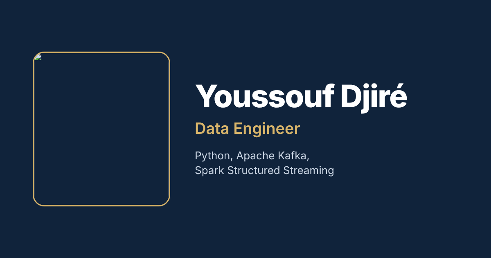

# Youssouf Djiré — Portfolio

Personal portfolio of **Youssouf Djiré**, Data Engineer (Python, Apache Kafka, Spark Structured Streaming).
The site is available in **English, French and Russian**, and the CV can be downloaded in each language.

**Live site:** https://yousking01.github.io/Porfolio_Youssouf/



## Features

- Three languages (English by default, French, Russian) with the visitor's choice remembered
- CV download as PDF in the language of your choice
- Light and dark mode, following the system setting until the visitor chooses
- Scroll animations, animated charts and counters, with reduced-motion support
- Charts built from real data: timeline of roles, data tools by domain, language levels
- Animated overview of the master's project pipeline (webcam to dashboard)
- Project filter (all, applications, websites)
- Contact section with clickable email, phone, Telegram, LinkedIn and GitHub
- Responsive layout for desktop, laptop, tablet and smartphone
- Keyboard navigation and visible focus
- SEO tags (description, Open Graph, structured data)

## Built with

| Tool | Use |
|---|---|
| HTML5, CSS3, JavaScript | Page, design and behaviour, with no framework |
| Bootstrap 5.2 | Grid, navigation bar and dropdown menus |
| Bootstrap Icons | Icons |
| Google Fonts (Onest, Inter) | Typography |

There is no build step and no server code. The site is fully static.

## Run it locally

Clone the repository:

```bash
git clone https://github.com/Yousking01/Porfolio_Youssouf.git
cd Porfolio_Youssouf
```

Then start a small local server.

With Python:

```bash
python -m http.server 8000
```

Open http://localhost:8000 in your browser.

With Visual Studio Code: install the **Live Server** extension, right-click `index.html` and choose **Open with Live Server**.

To open the site directly in a language, add `?lang=fr` or `?lang=ru` to the address.

## Project structure

```
index.html               The page, with the English text built in
assets/
  css/style.css          Design; colours and fonts are variables at the top
  js/i18n.js             All texts in en, fr and ru, plus the chart data
  js/main.js             Language switch, charts, filter, contact form
  img/                   Photo, logo, favicon, preview image
  pdf/                   CV in English, French and Russian
  vendor/                Bootstrap and Bootstrap Icons
```

## How to update the content

**Change a text.** Edit it in `assets/js/i18n.js` for `en`, `fr` and `ru`. Each key matches a `data-i18n` attribute in `index.html`. For English, also change the same text in `index.html`, because that is what search engines read.

**Replace a CV.** Overwrite the file in `assets/pdf/` and keep the same name:
`CV_Youssouf_Djire_EN.pdf`, `CV_Youssouf_Djire_FR.pdf` or `CV_Youssouf_Djire_RU.pdf`.

**Replace the photo.** Overwrite `assets/img/youssouf-djire.jpg` (640 × 720 pixels).

**Change the colours.** Edit the variables at the top of `assets/css/style.css`.

## Contact form

The form sends the message straight to the inbox through [FormSubmit](https://formsubmit.co), a free form-to-email service for static sites. No password or API key is stored in this repository.

**One-time activation.** The first message sent from the live site triggers an activation email from FormSubmit. Click the link in that email; after that, every message is delivered directly.

**Optional.** After activation, FormSubmit gives a random alias. Put it in `FORM_ENDPOINT` at the top of the contact-form section of `assets/js/main.js` (`https://formsubmit.co/ajax/<alias>`) to keep the address away from spam robots.

## Deployment

The site is published with GitHub Pages from the `main` branch. Every push to `main` updates the live site within a few minutes.

## Contact

- Email: djireyoussouf1999@gmail.com
- University email: djire01@tpu.ru
- Telegram: [@YouskingDjire](https://t.me/YouskingDjire)
- LinkedIn: [youssouf-djiré](https://www.linkedin.com/in/youssouf-djir%C3%A9-544302247)
- GitHub: [Yousking01](https://github.com/Yousking01)

© 2026 Youssouf Djiré
